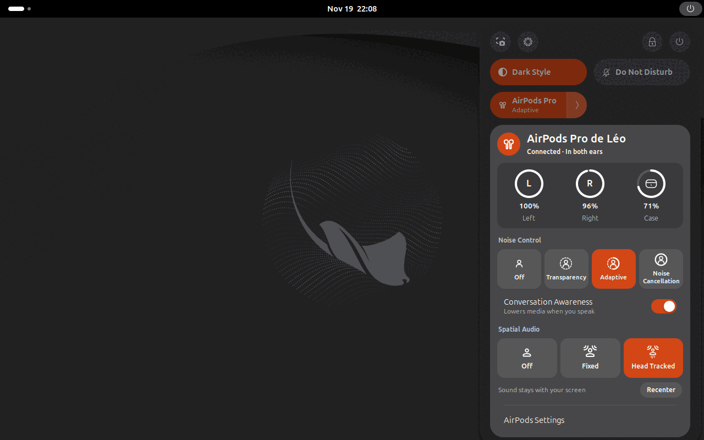
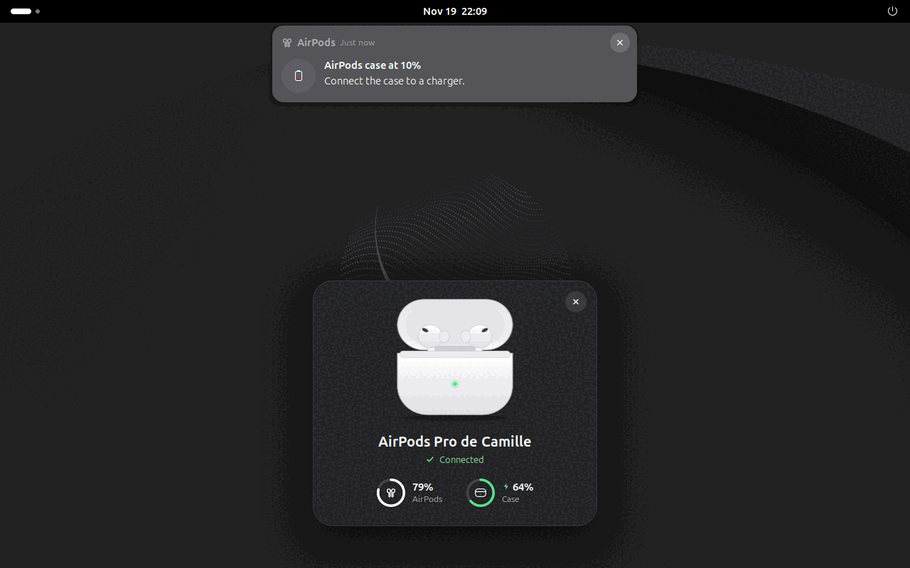
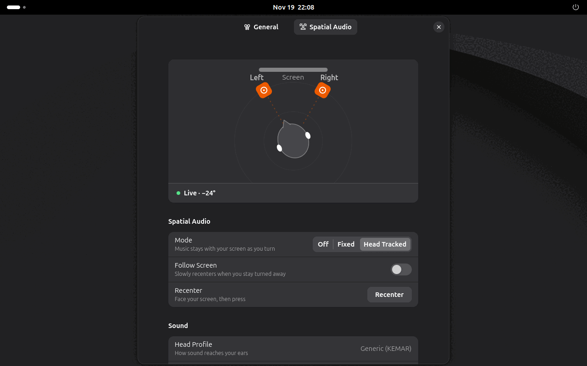

# Pods

AirPods work on Linux, but only as a plain Bluetooth headset. You don't get the
battery of each earbud, you can't switch noise cancellation, and there is no spatial
audio. Pods adds these controls to GNOME's Quick Settings, so the AirPods behave as
if they belonged on the desktop.

## What it does

- **Battery** of the left and right earbuds and of the case, in the menu and in
  GNOME's Power panel.
- **Noise control**: Off, Transparency, Noise Cancellation, and Adaptive on the models
  that have it. A click on the tile switches modes, like a long press on the stem.
  The Shell's on-screen display shows the new mode.
- **Ear detection**: the music pauses when you take an earbud out and resumes when you
  put it back.
- **Case card**: open the case near the computer and a card shows the batteries, or a
  Connect button when the AirPods are not connected to this computer.
- **Spatial audio**:
  - *Fixed* places the music in front of you.
  - *Head Tracked* keeps it with your screen when you turn your head, using the
    AirPods' motion sensors.
  - Recenter puts the scene back in front of you, and Follow Screen does it slowly by
    itself when you stay turned away.

Nothing is added to the top bar. Without connected AirPods, Pods shows nothing.

| The case card | Spatial audio in AirPods Settings |
|---|---|
|  |  |

## Install

1. Install the extension from [extensions.gnome.org](https://extensions.gnome.org)
   (search for *Pods*). It needs GNOME Shell 51.
2. Pods needs its engine, a small background service (`podsd`). When it is missing,
   *AirPods Settings* offers an **Install Engine** button. It downloads the engine from
   this repository's releases, checks it against the SHA-256 fingerprint the extension
   carries, and installs it in `~/.local/lib/pods` with a systemd user service. You
   don't need an administrator password, and **Uninstall Engine** removes it.

To build the engine yourself instead, see [engine/README.md](engine/README.md).

## Models

Tested with **AirPods Pro (1st generation)**. The protocol is shared across the
family, and the engine only shows what each model supports: Adaptive and Conversation
Awareness on the H2 models, head tracking on the models with motion sensors. Other
models should work. If something is missing or wrong on yours, please open an issue
with the model and what you saw.

## How it works

The AirPods speak a private protocol over Bluetooth (AAP, an L2CAP channel). The
engine opens that channel, listens to the case's Bluetooth advertisements without
scanning, and renders spatial audio inside PipeWire. The extension only talks to the
engine, over D-Bus. Details are in [docs/ARCHITECTURE.md](docs/ARCHITECTURE.md) and the
D-Bus contract is [docs/io.github.d101c.Pods1.xml](docs/io.github.d101c.Pods1.xml).

**Privacy**: everything stays on your computer. The keys that let the engine read the
case's advertisements are kept in your GNOME keyring and never written to a log.

## Credits

The engine builds on the work of others on the AirPods protocol:

- [podctl](https://github.com/Rockykln/podctl) (MIT): parts of the protocol code;
- [LibrePods](https://github.com/librepods-org/librepods): protocol documentation;
- [MousePods](https://github.com/starman-tech/mousepods) and
  [podtrack](https://github.com/f3nr1l/podtrack) (Apache-2.0): the head-tracking sensors.

The spatial audio icons are composed from [Material Symbols](https://github.com/google/material-design-icons)
(Apache-2.0). See `engine/NOTICE` and `extension/icons/NOTICE-material`.

## License

The extension is GPL-2.0-or-later and the engine is GPL-3.0-or-later.

AirPods is a trademark of Apple Inc. Pods is not affiliated with or endorsed by Apple.
